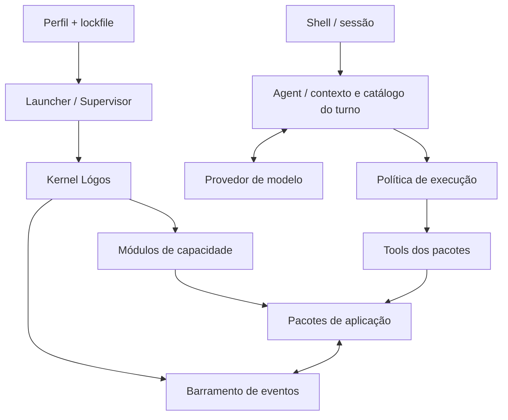

# ThinkIac

**Infraestrutura como código para desenvolver com agentes.** O ThinkIac dá ao agente um ambiente de trabalho composto por pacotes: repositórios, arquivos, terminal, modelos, ferramentas, aplicações e automações. O mesmo ambiente que o agente usa para trabalhar pode ser inspecionado, estendido e versionado por quem o opera.

A ideia original é dar ao agente um computador onde possa agir. Para quem desenvolve, isso significa poder rastrear uma ação até a ferramenta, o pacote, o contrato e a política que a autorizou. Um prompt pode pedir uma investigação no workspace, propor um novo pacote ou especificar como duas aplicações devem cooperar.

[Primeiro prompt](#primeiro-prompt) · [Arquitetura](#arquitetura) · [Eventos](#eventos) · [LogosType](#logostype) · [Mapa do perfil padrão](#mapa-do-perfil-padrão) · [Instalação](#instalação-por-perfis)

## Primeiro prompt

Inicie uma instância com o perfil padrão, configure um provedor de modelo disponível e abra o chat no Shell. Comece pedindo ao agente para descobrir as capacidades da instância que ele realmente está usando:

> No workspace desta sessão, localize o perfil ativo e a revisão instalada do pacote `agent`. Siga uma chamada de ferramenta desde a declaração até a descoberta, a autorização e o resultado. Cite arquivos e símbolos e indique o que dependeria de configuração ou de aprovação. Faça apenas leituras.

Para pedir uma mudança, diga **onde**, **qual contrato**, **até onde executar** e **como comprovar**. Três pedidos para usar como ponto de partida:

- **Diagnosticar uma tool.** “No pacote `<nome>`, encontre a declaração e o contrato da tool `<tool>`. Verifique se ela está registrada, se entra no catálogo desta sessão e qual política vale para chamá-la. Cite o primeiro ponto em que o caminho falha. Faça somente leituras.”
- **Integrar dois pacotes.** “No workspace `<caminho>`, proponha uma consulta de status de `<consumidor>` para `<provedor>`. Use uma chamada com retorno validado. Defina entrada, saída, nome qualificado, prazo e permissões mínimas. Liste testes para sucesso, saída inválida e cancelamento. Entregue o plano antes de alterar arquivos.”
- **Implementar com evidência.** “Em `<repo>`, adicione uma tool de leitura de status ao pacote `<nome>` usando a forma de registro ativa. Preserve as rotas existentes. Rode os testes do pacote, mostre o diff e informe se o Runtime chegou a carregar a mudança. Deixe a revisão local.”

Para trabalho orientado por especificação, consulte o [Engineer](https://github.com/ThinkIac/engineer). Onde esse fluxo estiver configurado, `/spec <pedido>` no Shell inicia uma especificação para revisão. O fluxo pode fixar a base Git e implementar em um worktree separado após aprovação.

<details>
<summary>Interface web</summary>


</details>

## Arquitetura



| Camada | O que procurar |
| --- | --- |
| Distribuição | O launcher resolve o perfil, instala gerações fixadas pelo lock e mantém o estado da instância fora dessas gerações. [Perfis](docs/profiles.md) · [Distribuição](docs/runtime-distribution.md) |
| Kernel Lógos | Descoberta de pacotes, dependências, autoridade e ciclo de vida. Os módulos dão significado às declarações e publicam capacidades no host. [Arquitetura](vendor/packages/logos/docs/architecture.md) · [Módulos](vendor/packages/logos/docs/modules.md) · [Workspace](vendor/packages/logos/docs/workspace.md) |
| Pacote | O manifesto e as declarações determinam quais ferramentas, comandos, hooks, rotas, serviços e views o pacote disponibiliza. Comece pelo `package.json` e siga até o provedor da declaração. [Integrações](vendor/packages/logos/docs/package-integrations.md) · [Decorators ativos](docs/decorators.md) |
| Turno do agente | O Agent compõe contexto, consulta o catálogo, chama o modelo e aplica a política antes de executar. A classificação seleciona candidatas. `auto`, `always` e `manual` controlam descoberta, e a política decide a chamada. [Agent](https://github.com/ThinkIac/agent) · [Classification](https://github.com/ThinkIac/classification) · [Specialists](https://github.com/ThinkIac/specialists) |
| Superfície e estado | O Shell organiza a sessão e a interface. HTTP, Svelte, WebSocket e MCP são capacidades fornecidas por módulos. A persistência e o acesso a credenciais seguem os contratos e a autoridade do host. [Autoridade](vendor/packages/logos/docs/authority.md) · [Acesso Scriba](docs/scriba-key-access.md) |

Quando os participantes implementam o ciclo transacional, uma geração candidata é preparada antes de ser publicada. Em caso de falha, o protocolo pode restaurar a geração anterior. Efeitos externos dependem da compensação implementada por cada participante. Ao pedir uma mudança em execução, indique se basta validar código ou se a tarefa exige carregar a geração e observar a capacidade ativa. [Ciclo de módulos](vendor/packages/logos/docs/modules.md)

## Eventos

O barramento Lógos conecta pacotes com três semânticas. A escolha da operação determina o que o chamador observa e como as falhas chegam até ele.

| Quero… | Operação | Contrato |
| --- | --- | --- |
| Avisar que algo ocorreu | `emit` | Entrega aos observadores. Registra falhas individuais e segue a entrega. |
| Enriquecer ou transformar um payload em etapas | `pipeline` | Executa por prioridade crescente e ordem de registro em empates. `undefined` e `null` preservam o valor atual. Se uma etapa falhar, segue com o valor anterior. |
| Pedir um resultado a outro pacote | `request` / `provide` no barramento, `ctx.events.requestResponse` / `provideResponse` no pacote | Um provedor por nome exato, entrada e saída validadas, falhas propagadas ao chamador e prazo padrão de 30 segundos. Aceita `timeoutMs` e `AbortSignal`. |

Nas chamadas com retorno, o provedor pode habilitar `before`, `transform` e `after`. As fases de observação recebem cópias e têm seus retornos ignorados. `transform` pode substituir o resultado quando a saída passa pelo contrato, inclusive por `null` quando permitido. As fases compartilham o prazo e o cancelamento. As APIs legadas `ctx.events.call` e `ctx.events.request` mantêm a semântica de pipeline.

**Autoridade faz parte do contrato.** A política de chamadas `$` do manifesto delimita os eventos externos que o pacote pode invocar. Quando habilitada, a governança de entrega avalia origem, destinatário, evento e operação, inclusive cada fase de extensão. Recibos de fluxo vinculam também o identificador do fluxo. Em chamadas aninhadas no mesmo processo, o barramento pode exigir autorização dos chamadores anteriores. Para investigar uma falha, peça a identidade qualificada, a operação, as fases habilitadas e o ponto em que a entrega foi negada ou expirou.

[Operações e compatibilidade](docs/logos-event-operations.md) · [Eventos tipados, extensões e governança](vendor/packages/logos/docs/events.md) · [Autoridade de pacotes](vendor/packages/logos/docs/authority.md)

## LogosType

**LogosType** estende CoffeeScript 2 com declarações de recursos tipados. O compilador `logostype` extrai assinaturas e metadados e produz JavaScript e declarações. O Lógos resolve os provedores e publica os recursos conforme os contratos e a autoridade do host.

```coffee
response compose = (message: string): string ->
  @extensions transform
  message.trim()
```

Com esse recurso publicado no pacote `agent`, um consumidor autorizado pode solicitar `agent::response:compose` por `ctx.events.requestResponse`, enviando um objeto com o argumento `message`. Outro pacote pode declarar um `extensionHook` para a fase `transform` habilitada. O exemplo ilustra a identidade resultante de uma declaração e pressupõe um pacote local com o provedor correspondente.

- `module` e `type` declaram provedores. `@tag` descreve os metadados que recebem. Recursos como `tool` e `task` precisam de provedores que os publiquem.
- Os parâmetros e o retorno vêm da assinatura. Diretivas estáticas como `@description` documentam o recurso. Modelos `.scriba` e `.schema` podem fornecer tipos e descrições de campos. O módulo de persistência controla o acesso a dados.
- `compileResource()` retorna `js`, `docs` e `declarations`. `compile()` continua disponível para CoffeeScript convencional. No host, o ciclo `prepare` → `commit` → `rollback` / `dispose` dá aos provedores pontos para publicar, compensar e descartar recursos.
- Para mudar um pacote existente, peça ao agente que identifique o registro que o módulo consome hoje. O módulo de tools do ThinkIac documenta `@register_tool` como forma ativa em JavaScript. [Decorators](docs/decorators.md)

[Repositório LogosType](https://github.com/ThinkIac/LogosType) · [Implementação e discussão da linguagem](https://github.com/ThinkIac/LogosType/pull/1) · [Revisão usada pelo perfil](https://github.com/ThinkIac/LogosType/tree/acdcc6032ab94219e0d4a4d25b1538fb55fa19cf) · [Referência de sintaxe, compilador e integração](vendor/packages/logos/docs/logos-type.md)

## Mapa do perfil padrão

Cada link abre o código na revisão fixada pelo [lockfile](profiles/default.lock.json). Use o [manifesto do perfil](profiles/default.json) para conferir os caminhos no workspace e o catálogo da sua sessão para descobrir o que está acessível naquele turno.

| Quero trabalhar com… | Pacotes e módulos |
| --- | --- |
| Agentes, roteamento e contexto | [agent](https://github.com/ThinkIac/agent/tree/355bcafcf7da6902d86c965d9a330ca5a9f5f3e3), [classification](https://github.com/ThinkIac/classification/tree/4bf8b554244f68c7d662d6a6cee60709a791becc), [specialists](https://github.com/ThinkIac/specialists/tree/136464ed207ad1466030ed1aae0113e4356e5e9d), [memory](https://github.com/ThinkIac/memory/tree/54aedddbd6f7a4633814dbb848b4b85a1f46ca91), [inflect](https://github.com/ThinkIac/inflect/tree/3246b4da1632541e962523dc517061ea9865de91) |
| Modelos e bridges | [providers](https://github.com/ThinkIac/providers/tree/619320cfbf11bdf813b25d6d7260ec3bc02b6c56), [openrouter](https://github.com/ThinkIac/openrouter/tree/3c4d1f428dd8ce14d4ac9babdcd12485f6791eff), [openai-bridge](https://github.com/ThinkIac/openai-bridge/tree/cef9e0ac2ee980fb0a3e0633db6dcca0b9fc6078), [hermes](https://github.com/ThinkIac/hermes/tree/80c4448712469dcc22fa80c01c4a97b3823107e8) |
| Código e workspace | [engineer](https://github.com/ThinkIac/engineer/tree/3a488202e335dc899754ba88ef9a7e1fe7f700af), [code-editor](https://github.com/ThinkIac/code-editor/tree/515eae5d48c7cf91ce7112a9b3396cf922b51c9f), [file-manager](https://github.com/ThinkIac/file-manager/tree/5cda5c0b4eacd1d77d7736c5dd890171a5f3b2b0), [github](https://github.com/ThinkIac/github/tree/7fb0dea872738521948b6befc8a143675886db5c), [terminal](https://github.com/ThinkIac/terminal/tree/ce3f85f092f01f6c2539700cbd17aaf25fae76cb), [repo](https://github.com/ThinkIac/repo/tree/270ea58d94d68a4dca974315461075d247719079) |
| Interface e conexões | [shell](https://github.com/ThinkIac/shell/tree/0dd9e448b9d363dbbe7e974379b0e53cbc5b53f8), [shell-runtime](https://github.com/ThinkIac/shell-runtime/tree/d70446bae08b128682cae0727cd8b070abd9b4ac), [ui-dialogs](https://github.com/ThinkIac/ui-dialogs/tree/2305a19978c457d2030aac36d3044f0e568a951d), [ui-schema](https://github.com/ThinkIac/ui-schema/tree/a8c1c06890fdca79feee22835673235da0dbef37), [svelte](https://github.com/ThinkIac/svelte/tree/d6a8e28165a9a770a31ade61db612385344a00ca), [http](https://github.com/ThinkIac/http/tree/3e81ba054b77b3990d7600cc0fc3b16d6d1b32d0), [websocket](https://github.com/ThinkIac/websocket/tree/b5f65a6e4d836eb459676324516410d2eeae4cbe), [websocket-runtime](https://github.com/ThinkIac/websocket-runtime/tree/86697faed78cf0c12f4110ffcd581f68134beedf), [redirect](https://github.com/ThinkIac/redirect/tree/5689395524db24b7d5a116b5c777b006f3cb1cb6) |
| Identidade, configuração e credenciais | [auth](https://github.com/ThinkIac/auth/tree/12ba2a2e3689ee09b77e40ae4fbb274fd4cdc7e2), [governance](https://github.com/ThinkIac/governance/tree/88abba31fa415a64f202b8661c58fb95eac97a3f), [settings](https://github.com/ThinkIac/settings/tree/5d38273f53052653d7983df293a106eefccd0665), [env](https://github.com/ThinkIac/env/tree/e68ffdeaf1d09e81605ea86b617e67690398d40f), [credentials](https://github.com/ThinkIac/credentials/tree/c038456d1a97a4ec1bd74dfe766db1ab866e51ca) |
| Ferramentas e integração MCP | [tools](https://github.com/ThinkIac/tools/tree/8ae71a22d17d785a7120d5272dbfa0eb3287271c), [commands](https://github.com/ThinkIac/commands/tree/58fdfd829171043ef60c47d118580b702cc9f6a8), [annotations](https://github.com/ThinkIac/annotations/tree/dd4ff3294d0943ed0ed3c6db805bc2cf8a9521b3), [hooks](https://github.com/ThinkIac/hooks/tree/e458a1b091af2482cbcd1875f10864b95429b4f9), [mcp](https://github.com/ThinkIac/mcp-settings/tree/23e87ab7134a6abfb865b28a1683db680a89ac56), [mcp-module](https://github.com/ThinkIac/mcp/tree/bf2063e87755d4c17e5e90a35eef83acf13893ab) |
| Persistência | [scriba](https://github.com/ThinkIac/scriba/tree/15cc82bcc5a4cf0e0f8ea590d273f438581028bd), [scriba-rooms](https://github.com/ThinkIac/scriba-rooms/tree/39760a2574ec745206fbd0bc1850bcc191815c74), [db](https://github.com/ThinkIac/db/tree/80ef5e8b9c4abae8f71e4a56c27169994ef43708), [storage](https://github.com/ThinkIac/storage/tree/c63413e2d5459ab7f7aaa3adb34153d313b2b864) |
| Processos, execução e isolamento | [proc](https://github.com/ThinkIac/proc/tree/1d106604c0e4fdcdd00f8b5799d2be370ca37262), [workers](https://github.com/ThinkIac/workers/tree/2f29aeaf5a960ba2aa4222b35bbc4d3ac3f097f7), [mediated-io](https://github.com/ThinkIac/mediated-io/tree/c7164cb8f2bdc3d85be7d56d7f4a5d589016067a), [process-bridge](https://github.com/ThinkIac/process-bridge/tree/48456b41418ce8904cf60841cc13678d2009fd63), [isolated-runtime](https://github.com/ThinkIac/isolated-runtime/tree/f41905d7a604039bda314b5c0bdacdd62ced1b09), [task-runner](https://github.com/ThinkIac/task-runner/tree/8cb8a9857e427d354341bc073f1a60de61c184f3) |
| Instalação, monitoramento e ciclo de vida | [pkgmgr](https://github.com/ThinkIac/pkgmgr/tree/be88ddc5869082bfb26bbf794207a87f467ba91e), [supervisor](https://github.com/ThinkIac/supervisor/tree/ab8191c4339e0457609998a156ae283a0749c9a6), [stabilizer](https://github.com/ThinkIac/stabilizer/tree/b85b49d49cca5fe63b5d612fd4c411bda1212564), [runtime-compat](https://github.com/ThinkIac/runtime-compat/tree/cdc7111e66614bb1ed4a80901b3363587b3e6f0a), [legacy-entry](https://github.com/ThinkIac/legacy-entry/tree/cfa2addb8dadcc30c420e4f339762fb955e02a49), [system-monitor](https://github.com/ThinkIac/system-monitor/tree/d266939a46fc5c70c8ab96fa29924e56cf28ba57), [reboot](https://github.com/ThinkIac/reboot/tree/8df0afd3fabc686e5692b251cc9f9d76ceeaf042) |

O [catálogo da organização](https://github.com/ThinkIac) reúne repositórios adicionais. Para pedir uma integração, informe o perfil de destino e peça ao agente que verifique se o pacote já está instalado, quais capacidades o manifesto exige e de que autoridade a execução precisa.

## Instalação por perfis

ThinkIac é uma distribuição do Lógos composta por perfis. A base contém o kernel,
o inicializador e referências Git. Módulos e aplicações são baixados ao executar
o perfil selecionado.

```sh
npm ci --legacy-peer-deps
npm start
```

O perfil padrão reproduz a composição publicada de `/code/think`: 25 pacotes de
capacidade, 24 aplicações, o runtime aninhado do Shell e as bibliotecas Scriba e
Inflect. Seu código não está incorporado neste repositório.

```json
{
  "dependencies": {
    "@thinkiac/module-hooks": "ThinkIac/hooks#main",
    "@thinkiac/module-http": "ThinkIac/http#main",
    "terminal": "ThinkIac/terminal#main"
  }
}
```

Esse é um trecho de perfil. Também são aceitas tags como `ThinkIac/hooks#1.0.0`
quando a tag existir. O lockfile registra os commits exatos; mudanças remotas em
`main` só entram com atualização explícita.

```sh
npm run profile:install                 # baixar e preparar, sem iniciar
npm run start:runtime                   # iniciar diretamente
npm run start:foreground                # Supervisor em primeiro plano
npm run profile:update                  # resolver novamente e atualizar o lock
npm start -- --profile ./meu-perfil.json
```

A instalação concluída é reutilizada nas próximas inicializações. Dados ficam
fora das gerações de código, em `.thinkiac/<perfil>/state`, ou no diretório
definido por `THINKIAC_HOME`. Não há importação automática de dados pessoais de
uma instalação anterior.

Requisitos: Node >=22.12, npm, Git, acesso aos repositórios selecionados e
ferramentas de compilação das dependências nativas do perfil. O primeiro boot
precisa de rede. Perfis com repositórios privados usam a autenticação Git do host.

- [Perfis, fluxo, exemplos, estado e limitações](docs/profiles.md)
- [Perfil padrão](profiles/default.json) e [lock](profiles/default.lock.json)
- [Lógos](vendor/packages/logos/README.md)
- [LogosType](https://github.com/ThinkIac/LogosType)
- [Segurança](SECURITY.md) e [contribuição](CONTRIBUTING.md)

## Validação da base

```sh
npm test
npm run build
node launcher/kernel-smoke.cjs
```

Os testes de cada módulo e aplicação ficam nos respectivos repositórios.
Instalar uma geração com sucesso não equivale a aceitar um deploy em produção.

## Instância local com npx

Com Node 22.12 ou superior, npm e Git, execute na pasta da instância:

```bash
npx github:ThinkIac/ThinkIac
```

No primeiro uso, o assistente solicita nome, perfil, portas HTTP e MCP e,
quando o perfil inclui Auth, e-mail administrativo. Escolha `default` para
usar a composição fornecida ou informe um JSON local acompanhado do
respectivo `.lock.json`. O Auth provisiona o administrador no primeiro boot
com a senha aleatória mostrada no terminal interativo.

O launcher usa `.thinkiac/` na pasta atual para guardar a configuração, o perfil,
o lockfile, as gerações instaladas e os dados persistentes. A credencial de
bootstrap fica em `.thinkiac/.env`, com modo `0600` em sistemas POSIX.
Mantenha `.thinkiac/` fora do controle de versão.

Em novas execuções, o mesmo comando reutiliza a configuração e inicia o runtime
em primeiro plano. Crie instâncias em pastas distintas com portas distintas.

Para preparar uma instância em automação:

```bash
npx --yes github:ThinkIac/ThinkIac --name demo --port 5040 --mcp-port 3333 --install-only
```

Remova `--install-only` para iniciar após configurar. Em execuções posteriores,
omita as opções de configuração e mantenha `--install-only` apenas se desejar
instalar sem iniciar. Consulte [Perfis](docs/profiles.md) para o formato e as
referências Git aceitas.
