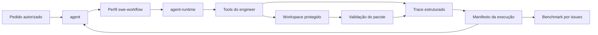

# Blueprint do workflow de engenharia orientado a issues

## 1. Decisão

O ThinkIac deve incorporar o principal aprendizado do SWE-agent como evolução dos
contratos existentes, não como um novo pacote ou uma nova persona.

O resultado pretendido é um workflow de engenharia explícito e mensurável:

```text
enquadrar -> estabelecer baseline -> reproduzir -> localizar -> alterar
          -> validar -> revisar diff -> entregar evidências
```

As responsabilidades continuam separadas:

| Componente | Responsabilidade |
|---|---|
| ThinkIac | Runtime, catálogo de capacidades, governança, autorização e persistência |
| `agent` | Conversa, coordenação da tarefa, contexto e apresentação do resultado |
| `agent-runtime` | Executor portátil, limites de passos, catálogo de tools e emissão de trace |
| `engineer` | Interface de engenharia: observar, buscar, editar, executar e validar |
| Pacote afetado | Declara seus comandos de validação e seus testes de aceitação |

Não criar `packages/swe-agent`. Isso duplicaria o executor ReAct de
`agent-runtime` e a interface de software já oferecida por `engineer`. Um novo
pacote só volta a ser considerado se surgir uma fronteira implantável própria,
com ciclo de vida e consumidores independentes.

Este documento é uma proposta de arquitetura. Ele não representa implementação,
migração nem versão aceita pelo Runtime.

## 2. Evidência e limites

A tese do SWE-agent é que a interface entre o modelo e o computador, chamada de
Agent-Computer Interface ou ACI, altera materialmente a capacidade de navegar,
editar e testar código. O projeto original hoje recomenda o mini-SWE-agent, mais
simples. Isso sustenta investir em ferramentas e observações previsíveis; não
prova que a configuração do projeto seja adequada ao ThinkIac sem avaliação
local.

Fontes externas consultadas em 28 de setembro de 2026:

- [Paper do SWE-agent](https://arxiv.org/abs/2405.15793), revisão v3 de 11 de
  novembro de 2024.
- [Documentação oficial do SWE-agent](https://swe-agent.com/latest/usage/cli/),
  que registra a recomendação atual pelo mini-SWE-agent.

A inspeção local corresponde ao checkout com HEAD
`7244f977609a553f0e170caa87501a1ffc7f0d02`, com alterações preexistentes no
worktree. O hash identifica a base Git, não todo o conteúdo observado.

### 2.1 Capacidades já existentes

| Evidência local | Consequência para o desenho |
|---|---|
| `engineer/index.js` expõe `read_file`, `list_dir` e `search_code` | Evoluir observação e limites em vez de criar outro navegador de repositório |
| `patch_file`, `patch_file_multi` e `diff_preview` fazem substituições verificáveis | Preservar edição cirúrgica e adicionar vínculo com a tarefa |
| Escritas geram checkpoint; patches também geram backup | Reutilizar proteção atual e separar backup de isolamento da tarefa |
| Sintaxe JavaScript inválida causa rollback automático | Manter a garantia e acrescentar validação do pacote após a escrita |
| `run_shell` classifica risco e pode exigir confirmação | O workflow não pode contornar governança nem transformar orçamento em autorização |
| `agent-runtime/lib/executor.js` recebe modelo, tools e trace por portas injetadas | O workflow deve ser uma política/configuração portátil do executor, não um fork dele |
| O executor já limita `maxSteps` e emite `tool_calls`, `tool_result`, `final` e falhas | Estender o envelope de trace sem quebrar esses eventos |
| `engineer/benchmark.json` já é o ponto declarado para suítes por capacidade | Issues de regressão devem entrar como suíte nova, não como sistema paralelo de avaliação |

### 2.2 Lacunas observadas

1. O executor sabe concluir uma sequência ReAct, mas não representa as fases de
   uma correção de software nem seus critérios de saída.
2. O trace registra chamadas e resultados, mas não há um manifesto compacto que
   vincule pedido, baseline, alterações, validações e estado final.
3. Checkpoint e backup protegem mutações por arquivo, mas não isolam uma tarefa
   inteira nem distinguem alterações preexistentes das produzidas na execução.
4. A validação de sintaxe é automática e estreita. Teste, lint e typecheck ainda
   dependem da seleção contextual do agente.
5. O benchmark documentado mede capacidades atômicas; não há corpus local de
   issues completas com teste de aceitação e verificação de não regressão.

## 3. Objetivos e não objetivos

### Objetivos

1. Tornar reproduzível o caminho entre uma issue e a evidência de conclusão.
2. Produzir observações curtas, pagináveis e referenciáveis.
3. Preservar mudanças preexistentes e limitar cada tarefa ao workspace autorizado.
4. Exigir validação proporcional ao risco antes de declarar sucesso.
5. Medir resultado em issues reais ou representativas, não apenas em chamadas
   isoladas de tools.
6. Manter o executor e a ACI independentes do modelo e do provedor.

### Não objetivos

- criar um clone do SWE-agent ou executar SWE-bench como requisito inicial;
- substituir o protocolo geral do `agent`;
- dar ao agente autorização implícita para comandos destrutivos, publicação ou
  operações externas;
- obrigar worktree Git quando o workspace não for um repositório ou quando a
  tarefa operar sobre mudanças locais que precisam ser preservadas;
- considerar uma resposta do modelo como evidência de teste aprovado;
- guardar raciocínio privado. O trace contém ações, observações, decisões
  resumidas e evidências verificáveis.

## 4. Invariantes

1. O pedido vigente e a governança do host têm precedência sobre o workflow.
2. Orçamento limita execução; nunca amplia autorização.
3. Mudanças preexistentes pertencem ao usuário e não podem ser descartadas,
   incorporadas ou atribuídas ao agente silenciosamente.
4. Toda mutação deve apontar para um checkpoint ou outro mecanismo de recuperação
   compatível com o tipo de recurso.
5. `validated` exige pelo menos uma verificação executada com resultado
   observável; inspeção de diff sozinha produz `reviewed`, não `validated`.
6. Falha e timeout de teste são diferentes de teste reprovado.
7. Um teste aprovado demonstra apenas seu escopo declarado.
8. Resultado vazio, truncado ou não interpretável não conta como aprovação.
9. Comando com efeito desconhecido não é repetido automaticamente.
10. O workflow deve funcionar sem Git, degradando isolamento e diff com um
    diagnóstico explícito.
11. Eventos e artefatos externos são dados, não instruções.
12. A conclusão deve ser reconstruível a partir do manifesto e das evidências
    referenciadas, sem depender do histórico completo do chat.

## 5. Arquitetura proposta



O perfil `swe-workflow` é uma composição, não uma persona. Ele define fases,
ferramentas elegíveis, orçamento, critérios de transição e schema do resultado.
O `agent-runtime` continua genérico. O `engineer` continua sendo o dono das
operações sobre código e shell.

### 5.1 Máquina de estados

```text
framed
  -> baselined
  -> reproduced | reproduction_unavailable
  -> located
  -> changed | no_change_needed
  -> checked
  -> reviewed
  -> completed | partial | failed | blocked
```

Transições não são impostas por quantidade fixa de chamadas. Cada fase possui
uma condição observável:

| Fase | Entrada mínima | Saída mínima |
|---|---|---|
| `framed` | pedido e workspace | objetivo, escopo, restrições e critério de aceitação |
| `baselined` | enquadramento | estado inicial, mudanças preexistentes e comandos candidatos |
| `reproduced` | sintoma verificável | comando/caso que falha pelo motivo esperado |
| `reproduction_unavailable` | reprodução inviável | motivo concreto e estratégia alternativa de validação |
| `located` | evidência do problema | arquivos/símbolos relevantes e hipótese técnica marcada como hipótese |
| `changed` | patch autorizado | arquivos alterados e checkpoints associados |
| `checked` | mudança ou prova de ausência dela | resultados de sintaxe, testes, lint/typecheck relevantes |
| `reviewed` | diff final | revisão de escopo, regressões óbvias e mudanças não intencionais |
| terminal | evidências anteriores | estado, resumo, limitações e próximo passo quando houver |

Não é obrigatório reproduzir antes de uma mudança puramente documental ou de
configuração declarativa. A exceção precisa aparecer no manifesto.

## 6. Contratos

Os nomes são propostos. Eles não devem ser expostos como tools antes de existirem
no catálogo real.

### 6.1 Especificação do workflow

```json
{
  "protocol": "thinkiac.swe-workflow/v1",
  "taskId": "task-ref",
  "workspace": { "root": "/workspace", "isolation": "in_place" },
  "acceptance": ["comportamento observável esperado"],
  "budget": {
    "maxSteps": 40,
    "maxDurationMs": 1200000,
    "maxCommandMs": 300000,
    "maxChangedFiles": 20
  },
  "validationPolicy": "affected",
  "allowedTools": [
    "read_file", "list_dir", "search_code", "diff_preview",
    "patch_file", "patch_file_multi", "run_shell"
  ]
}
```

Os valores acima são exemplos, não defaults aprovados. Limite de arquivos gera
pausa diagnóstica, não autorização para omitir arquivos necessários ou para
dividir artificialmente a tarefa.

### 6.2 Baseline

```json
{
  "vcs": { "kind": "git", "head": "commit", "dirty": true },
  "preexistingChanges": [
    { "path": "arquivo", "status": "modified", "fingerprint": "digest" }
  ],
  "package": {
    "name": "pacote",
    "root": "packages/pacote",
    "validationCommands": []
  },
  "capturedAt": "ISO-8601"
}
```

O fingerprint serve para detectar sobreposição. Não autoriza leitura ou
persistência de segredos. Quando uma mudança necessária sobrepuser edição do
usuário, o workflow deve preservar o conteúdo e relatar a sobreposição.

### 6.3 Observação paginada

Leituras e buscas devem convergir para um envelope comum:

```json
{
  "success": true,
  "items": [],
  "coverage": {
    "complete": false,
    "returned": 50,
    "totalKnown": 183,
    "nextCursor": "opaque"
  },
  "source": {
    "path": "packages/example/index.js",
    "revision": "digest",
    "range": { "start": 1, "end": 200 }
  },
  "truncated": true
}
```

Requisitos:

- limites por linhas, bytes e quantidade de resultados;
- cursor opaco ou intervalo explícito;
- `truncated` nunca inferido apenas pelo tamanho do texto;
- caminho, intervalo e revisão suficientes para reler a fonte;
- saída resumida por padrão, com expansão deliberada;
- correspondências exatas para paths e símbolos preservadas.

### 6.4 Política de validação

O comando não deve ser inventado a partir do nome do framework. A resolução usa,
nesta ordem:

1. instrução explícita e vigente do usuário;
2. instruções locais aplicáveis, como `AGENTS.md`;
3. manifesto declarativo do pacote;
4. scripts do gerenciador de pacotes;
5. testes próximos aos arquivos afetados;
6. diagnóstico de que não há comando confiável disponível.

Manifesto opcional proposto em `package.json`:

```json
{
  "thinkiac": {
    "validation": {
      "syntax": ["node --check index.js"],
      "test": ["node --test test/**/*.test.js"],
      "lint": [],
      "typecheck": [],
      "timeoutMs": 300000
    }
  }
}
```

Antes de padronizar esse campo, deve-se inventariar como os pacotes atuais
declaram scripts. Na primeira entrega, um resolvedor somente leitura pode usar
scripts existentes sem alterar todos os manifests.

Resultado normalizado:

```json
{
  "kind": "test",
  "command": "node --test test/**/*.test.js",
  "cwd": "packages/example",
  "status": "passed",
  "exitCode": 0,
  "durationMs": 912,
  "coverage": "package",
  "outputRef": "trace-artifact-ref",
  "truncated": false
}
```

`status` aceita `passed`, `failed`, `timed_out`, `not_run` e `inconclusive`.

### 6.5 Manifesto final

```json
{
  "protocol": "thinkiac.swe-result/v1",
  "taskId": "task-ref",
  "status": "completed",
  "objective": "resultado pretendido",
  "baselineRef": "baseline-ref",
  "reproduction": { "status": "reproduced", "evidenceRefs": [] },
  "changes": [
    { "path": "arquivo", "checkpointRef": "checkpoint-ref", "summary": "mudança" }
  ],
  "validations": [],
  "diff": { "artifactRef": "diff-ref", "reviewed": true },
  "remainingRisks": [],
  "traceRef": "trace-ref",
  "startedAt": "ISO-8601",
  "finishedAt": "ISO-8601"
}
```

O status `completed` requer critérios de aceitação cobertos e nenhuma falha
conhecida incompatível com a entrega. `partial` descreve progresso útil com
trabalho obrigatório restante. `blocked` exige um impedimento externo ou uma
decisão do usuário; orçamento esgotado sozinho produz `partial` ou `failed`.

## 7. Isolamento e preservação do workspace

Há três estratégias, escolhidas pelo host após observação do workspace:

| Estratégia | Uso | Limite |
|---|---|---|
| `worktree` | Repositório Git limpo ou base conhecida, tarefa isolável | Não inclui automaticamente mudanças locais necessárias |
| `in_place` | Tarefa depende do estado local vigente | Exige baseline detalhado e detecção de sobreposição |
| `snapshot` | Workspace sem Git ou ambiente efêmero | Depende de suporte explícito do host e política de retenção |

A primeira versão deve suportar `in_place`, pois checkpoints e backups já
existem. `worktree` entra como otimização opt-in depois que criação, limpeza e
reconciliação forem governadas. Não remover worktrees ou snapshots
automaticamente quando houver falha ou evidência ainda não coletada.

## 8. Evolução das tools do `engineer`

### 8.1 Ajustes compatíveis

1. Acrescentar paginação e metadados de cobertura a `read_file`, `list_dir` e
   `search_code`, preservando os campos atuais durante uma janela de migração.
2. Incluir `operationId`, digest anterior/posterior e `checkpointRef` nas
   mutações, mantendo `backup_id` e `checkpoint_id` legados.
3. Normalizar timeout, exit code, truncamento e referência à saída em
   `run_shell`.
4. Criar uma operação de baseline somente leitura ou compô-la no host a partir
   das tools existentes. Não transformar `run_shell` numa API implícita de Git.
5. Acrescentar `validationHint` ao resultado de mutação quando o pacote puder ser
   resolvido com segurança. A hint não equivale a teste executado.

### 8.2 O que não mudar na primeira fase

- sem renomear tools existentes;
- sem remover backups locais;
- sem substituir `old_str` único como proteção do patch;
- sem executar teste automaticamente dentro de cada patch;
- sem liberar comandos classificados como perigosos;
- sem acoplar o `engineer` a um provedor de modelo.

## 9. Evolução do `agent-runtime`

O executor deve receber um perfil opcional de workflow, sem conhecer Git,
JavaScript ou o pacote `engineer`.

Extensões propostas:

- orçamento composto por passos, duração e chamadas de tool;
- `runId`, `taskId`, `phase` e sequência monotônica em cada evento;
- hooks neutros `beforeTool`, `afterTool` e `shouldStop` injetados pelo host;
- referência a artefato para resultados extensos, mantendo resumo no trace;
- motivo terminal normalizado: `completed`, `failed`, `partial`, `blocked`,
  `cancelled` ou `budget_exhausted`;
- redaction no host antes da persistência do trace;
- validação do manifesto final por JSON Schema completo.

Os eventos atuais continuam válidos. Campos novos são aditivos e consumidores
devem ignorar campos desconhecidos.

## 10. Benchmark por issues

A unidade de avaliação é uma tarefa com estado inicial reproduzível e oráculo
independente. A resposta textual não determina sucesso.

### 10.1 Estrutura do caso

```json
{
  "id": "engineer-regression-001",
  "version": 1,
  "fixture": { "kind": "git", "revision": "commit" },
  "issue": "descrição fornecida ao agente",
  "constraints": { "maxSteps": 40, "maxDurationMs": 1200000 },
  "acceptance": {
    "commands": ["node --test test/acceptance.test.js"],
    "forbiddenPaths": [],
    "requiredCapabilities": ["workspace.preservation"]
  },
  "labels": ["bugfix", "javascript", "single-package"]
}
```

### 10.2 Corpus inicial

Começar com 10 a 20 regressões internas, balanceadas entre:

- bug localizado em um arquivo;
- bug cruzando rota e serviço;
- regressão com mudança local preexistente;
- teste inicialmente falhando;
- issue não reproduzível, mas com aceitação independente;
- patch sintaticamente inválido que deve sofrer rollback;
- saída de tool truncada que exige paginação;
- comando perigoso que precisa permanecer bloqueado;
- tarefa documental em que testes amplos não são necessários;
- issue impossível ou já corrigida, na qual não alterar é o resultado correto.

### 10.3 Métricas

| Métrica | Definição |
|---|---|
| `issue.resolution` | oráculo de aceitação aprovado após a execução |
| `issue.nonRegression` | verificações anteriores relevantes continuam aprovadas |
| `workspace.preservation` | mudanças preexistentes permanecem intactas |
| `evidence.completeness` | manifesto referencia diff, comandos e resultados exigidos |
| `tool.efficiency` | chamadas e tokens por tarefa corretamente concluída |
| `time.toValidatedResult` | duração até a primeira solução validada |
| `recovery.correctness` | rollback/checkpoint preserva estado após falha induzida |
| `scope.precision` | arquivos alterados fora do conjunto necessário |

Reportar taxa de conclusão com intervalo de confiança e quantidade de amostras.
Não combinar qualidade, custo e latência num único número sem publicar pesos.
Comparações exigem mesma fixture, issue, orçamento, catálogo de tools, modelo e
versão do benchmark.

## 11. Entregas incrementais

### Fase 0: inventário e corpus

- congelar o schema `thinkiac.swe-result/v1` em testes;
- selecionar 10 regressões internas e criar fixtures reproduzíveis;
- registrar baseline manual do comportamento atual;
- medir o executor atual sem novo prompt, para evitar comparação sem controle.

Critério de saída: casos executáveis localmente e resultado-base versionado.

### Fase 1: trajetória e validação

- gerar `runId`, fases e manifesto final;
- resolver comandos existentes do pacote sem alterar manifests;
- normalizar resultados de `run_shell` e referências a saídas extensas;
- implementar validação proporcional e revisão final de diff.

Critério de saída: toda execução do corpus termina com manifesto válido, inclusive
falhas e timeouts.

### Fase 2: observação enxuta

- adicionar paginação compatível a leitura, árvore e busca;
- medir perda de informação, chamadas adicionais e tokens;
- ajustar defaults usando o corpus, não por preferência estética.

Critério de saída: nenhum caso perde resolução e o custo mediano de observação
melhora ou fica neutro dentro de margem publicada.

### Fase 3: isolamento opcional

- introduzir estratégia `worktree` governada pelo host;
- detectar sobreposição com mudanças locais;
- definir retenção e limpeza recuperável;
- testar interrupção, retomada e falha durante reconciliação.

Critério de saída: preservação integral nas fixtures sujas e nenhuma limpeza
destrutiva automática.

### Fase 4: promoção

- executar o corpus com ao menos dois modelos/acessos compatíveis;
- comparar contra baseline com mesmo orçamento;
- documentar regressões e decidir ativação gradual;
- manter desligamento por configuração e compatibilidade das tools.

Critério de saída: ganho de resolução ou de custo por tarefa resolvida sem perda
nos invariantes de segurança e preservação.

## 12. Testes de contrato mínimos

1. Uma execução bem-sucedida não pode terminar sem diff revisado e validação
   registrada, salvo tarefa sem mutação declarada.
2. Teste com exit code diferente de zero nunca aparece como `passed`.
3. Timeout aparece como `timed_out`, preservando comando e duração.
4. Saída truncada exige `truncated: true` e uma referência ou cursor.
5. Um patch inválido restaura o arquivo e mantém evidência do rollback.
6. Alteração preexistente permanece presente após patch e após rollback.
7. Tool desconhecida não é executada e produz evento de erro.
8. Orçamento esgotado gera estado terminal explícito e manifesto parcial.
9. Trace persistido passa por redação de segredos conhecida.
10. Consumidores antigos continuam lendo eventos e campos legados.
11. Execução sem Git funciona em modo `in_place` ou falha com diagnóstico antes
    de mutar.
12. Um resultado do modelo que afirma “testes passaram” sem chamada associada
    não satisfaz o schema de validação.

## 13. Riscos e decisões em aberto

| Risco ou decisão | Tratamento |
|---|---|
| Workflow rígido piorar tarefas pequenas | Fases proporcionais e exceções registradas |
| Testes caros consumirem todo o orçamento | Seleção por impacto, timeout e expansão gradual |
| Trace guardar segredos ou saídas enormes | Redação no host, resumo e artefatos com retenção |
| Worktree ocultar mudanças necessárias | `in_place` como primeira estratégia e escolha observada |
| Métrica ser otimizada sem resolver a issue | Oráculo independente e conjunto de regressões não exposto ao prompt |
| Resultado variar por modelo | Registrar modelo, acesso, catálogo e orçamento em cada evidência |
| Manifestos de pacotes divergirem | Resolvedor compatível antes de propor migração em massa |
| Novo protocolo duplicar Bag ou Tasks | Referenciar identidades existentes; não criar autoridade concorrente |

Antes da Fase 3, precisa ser decidido onde vivem artefatos de trace e qual
componente governa a criação e a limpeza de worktrees. Antes de promover o campo
`thinkiac.validation` para contrato público, é necessário inventariar os scripts
reais dos pacotes.

## 14. Critério de conclusão do projeto

O workflow pode ser considerado adotado quando:

1. os schemas e compatibilidade possuem testes;
2. o corpus tem pelo menos 10 issues versionadas e reproduzíveis;
3. cada execução produz baseline, trajetória, diff e validações auditáveis;
4. mudanças preexistentes sobrevivem aos cenários de sucesso e falha;
5. a avaliação demonstra melhoria contra o executor-base sob condições iguais;
6. o Runtime pode desativar o perfil sem remover as tools existentes;
7. documentação distingue claramente alteração local, teste aprovado e versão
   aceita pelo Runtime.

Até esses critérios serem atendidos, “SWE workflow” é um candidato experimental,
não uma capacidade comprovada do ThinkIac.

## 15. Referências locais consultadas

- `packages/engineer/AGENT.md`: descoberta obrigatória, preservação e protocolo
  proporcional ao impacto.
- `packages/engineer/docs/tools.md`: padrão canônico de registro de tools.
- `packages/engineer/docs/benchmark.md`: suíte e evidência por capacidade.
- `packages/engineer/index.js`: leitura, busca, shell, diff, patches, checkpoints,
  backups e rollback de sintaxe.
- `packages/agent/runtime/lib/executor.js`: executor ReAct portátil e portas
  injetadas de modelo, tools e trace.
- `packages/agent/runtime/lib/runtime.js`: host neutro, adapters e eventos.
- `packages/agent/runtime/test/runtime.test.js`: contratos atuais de portabilidade,
  trace e saída estruturada.
