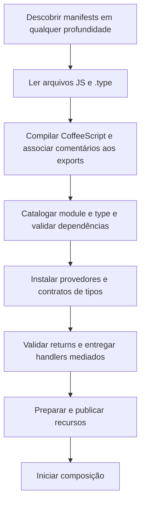
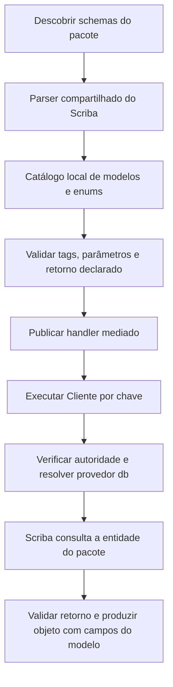

# LógosType: arquivos `.type`

A primeira versão de LógosType usa **CoffeeScript 2 convencional**, sem gramática
adicional. O compilador vem de [ThinkIac/LogosType](https://github.com/ThinkIac/LogosType),
um fork do CoffeeScript. O Lógos descobre, compila em memória e carrega `.type`
nativamente, junto de `.js`, `.cjs` e `.mjs` no mesmo pacote. Não há build manual
nem arquivos JavaScript gerados no workspace.

## Instalação pelo GitHub

A instalação direta foi validada:

```bash
npm install ThinkIac/LogosType#main
```

O nome atual do pacote nesse repositório é `coffeescript`. Portanto, a dependência
no manifest do Lógos é:

```json
{
  "dependencies": {
    "coffeescript": "github:ThinkIac/LogosType#main"
  }
}
```

Não é necessário instalar novamente no pacote consumidor: o Lógos distribui essa
dependência de linguagem. Ela não instala provedores de HTTP, views ou banco.
O compilador é carregado somente ao processar `.type`. `#main` acompanha a branch;
o `package-lock.json` da raiz fixa o commit resolvido para instalações com `npm ci`.
Para atualizar o compilador, atualize também esse lockfile e execute os testes.
A instalação Git requer acesso ao GitHub.

## Comentários e exports

O bloco `###` fica imediatamente acima da função, na primeira coluna.
`@register` e `# @register` são equivalentes, assim como os outros metadados.
Somente funções registradas ganham export automático; auxiliares ficam locais.
Exports CommonJS explícitos continuam aceitos, inclusive exportar a mesma função
pelo mesmo nome. Exportar uma função diferente com esse nome gera erro.

```coffee
formatar = (nome) -> nome.trim()

###
@register mensagem boasVindas
@returns "string"
###
boasVindas = (cliente) -> "Olá, #{formatar cliente.nome}!"
```

O nome omitido em `@register mensagem` usa o nome da função. `@name` continua
aceito. Comentários internos à função não registram declarações nesta versão.
Textos contendo `###` não são confundidos com comentários pelo lexer.
A extensão não instala provedores automaticamente.

Em `.type`, `@register module tarefa` e `@register type tarefa` são aliases completos:
ambos recebem o contexto, retornam um descritor, oferecem consumidores em `resources`
e participam dos mesmos ciclos de dependências, instalação e encerramento.
Declarar os dois com o mesmo nome é conflito, mesmo no mesmo arquivo.

### Contratos de função anteriores (compatibilidade)

No formato anterior, consumidores de provedores `.type` declaram uma entrada
em `contracts`, com `input` e `output`. Novos provedores podem usar `@tag`,
conforme a seção de contratos JSDoc abaixo. `input` é uma tupla de argumentos posicionais;
`[]` significa nenhum argumento. Cada recurso que usa um contrato deve declarar
exatamente um `@returns`, em JSON, igual ao tipo de saída do provedor.
O contrato é validado antes da publicação. A chamada valida argumentos antes de
executar o handler e valida o resultado após resolver eventual Promise.

Tipos iniciais: `"string"`, `"number"` finito, `"boolean"`, `"null"`, `"void"`,
objetos com campos obrigatórios e arrays com um tipo de elemento. Por exemplo:

```coffee
contracts:
  saudacao:
    input: [{nome: "string"}]
    output: "string"
  listar:
    input: []
    output: [{id: "number", nome: "string"}]
```

O recurso de `listar` usa `@returns [{"id":"number","nome":"string"}]`.
Objetos aceitam campos extras; não há coerção. `"void"` exige `undefined`.
Tipos desconhecidos, argumentos ausentes ou extras e campos obrigatórios ausentes
produzem erro com pacote, recurso e caminho do valor. Não há `any`, uniões,
genéricos nem inferência estática nesta versão. A gramática CoffeeScript permanece
convencional: a tipagem é um contrato verificado em execução.

**Compatibilidade:** os adaptadores JavaScript anteriores continuam aceitos sem
migração forçada; seu `@register type` conserva o consumidor direto. Um provedor
JavaScript pode adotar o novo descritor com `@provider descriptor`, usando o mesmo
contrato obrigatório e aliases. Scanners de capacidades legadas (como HTTP e hooks)
conservam seus contratos próprios; esta tipagem cobre handlers de recursos
genéricos entregues pelo protocolo. Chamar diretamente uma função local ou importada
não passa pela mediação do catálogo.

## Provedor e consumidor completos

A posição no workspace não muda a semântica:

```text
packages/
├── modules/arithmetic/
│   ├── package.json
│   └── index.type
└── abc/b/customer/
    ├── package.json
    └── actions.type
```

`modules/arithmetic/package.json`:

```json
{ "name": "@example/arithmetic" }
```

`modules/arithmetic/index.type`:

```coffee
###
@register type arithmetic
###
arithmetic = (context) ->
  contracts:
    arithmetic:
      input: ["number"]
      output: "number"
  resources:
    arithmetic: (resource) ->
      context.state.set resource.declaration.name, resource.handler
  close: -> context.state.clear()
```

`abc/b/customer/package.json`:

```json
{ "name": "customer" }
```

`abc/b/customer/actions.type`:

```coffee
###
@register arithmetic double
@returns "number"
###
double = (value) -> value * 2
```

Host JavaScript:

```js
const path = require('node:path');
const { bootstrap } = require('logos');

async function main() {
  const runtime = await bootstrap({
    workspace: path.resolve('packages'),
    externalModules: [],
  });
  try {
    const state = runtime.container.state('entrypoint:workspace:modules/arithmetic');
    console.log(await state.get('double')(21)); // 42
  } finally {
    await runtime.close();
  }
}
main().catch(error => { console.error(error); process.exitCode = 1; });
```

Não há import de API de registro do Lógos nos arquivos `.type`. Como em JavaScript,
o consumidor simples desse exemplo não reverte efeitos arbitrários. Para recursos
que exigem troca atômica, implemente o consumidor transacional descrito em
[modules.md](modules.md#transactional-resource-consumers).

## Fluxo



O Lógos conhece o formato de execução e as declarações estruturais. Os módulos
continuam responsáveis pela semântica de router, tool, view e outros recursos.
A descoberta estrutural e a descoberta de recursos usam o mesmo compilador.

## Dependências, recarga e diagnósticos

Um `.type` pode carregar CommonJS, JSON, bibliotecas npm e outro `.type` local:

```coffee
helper = require './lib/helper.type'
###
# @register arithmetic answer
# @returns "number"
#
###
answer = -> helper.answer()
```

Para dependências `.type`, escreva a extensão explicitamente. O carregador local
não instala `require.extensions` global. Importar `.type` diretamente por `require`
de um arquivo JavaScript ou por `import` ESM não é parte desta primeira versão.
Os `.type` descobertos pelo Lógos usam CommonJS inclusive em pacotes com
`"type": "module"`; `import` e `export` ESM dentro deles não são suportados.

A recarga invalida o cache CommonJS do pacote, incluindo helpers `.type`.
O estabilizador observa esses fontes e os inclui no hash dos candidatos.
Erros de compilação ou preparação impedem a publicação da nova geração;
consumidores transacionais conservam a geração ativa. Código de topo de arquivo
continua sendo código executável: efeitos fora do protocolo não ganham rollback.
Mudanças em definições de módulos e tipos continuam exigindo novo boot, assim
como em JavaScript.

Erros de sintaxe incluem o caminho `.type` e a localização do compilador.
O JavaScript em memória contém source map inline com o fonte original. Para
stacks de execução mapeados às linhas CoffeeScript, inicie Node com:

```bash
node --enable-source-maps host.cjs
```

## Isolamento

Pacotes isolados compilam e executam dentro do processo limitado fornecido por
`isolated-runtime`. O bootstrap recebe leitura do carregador de linguagem e do
compilador; o código do pacote continua sem import livre de módulos nativos,
sem import fora da própria raiz e com chamadas mediadas por IPC.
Dependências `.type` passam pela verificação do caminho real antes de carregar.
A compilação não cria uma nova fronteira de segurança nem concede capacidades.

## Validação

```bash
npm run build
npx vitest run tests/type-source.test.ts tests/resource-types.test.ts
npm run test:independent
```

Os testes cobrem blocos com `#`, funções anônimas, router e `@name`, módulos e tipos
em pastas profundas, coexistência com JavaScript, dependências locais, source maps,
recarga, erro de compilação, candidatos e execução isolada com bloqueio de escapes.
O teste de distribuição usa o artefato empacotado em projeto temporário sem módulos
adjacentes; copia o compilador instalado para manter essa verificação offline.

## Contratos JSDoc de metadados e modelos Scriba

O provedor pode definir o formato das declarações que aceita usando `@tag`.
Isso atende à tipagem dos **metadados do recurso**, além da assinatura da função.
`module` e `type` continuam aliases. O formato anterior `contracts.input/output`
continua aceito. Para novos provedores `.type`, declare `@tag` ou os contratos
anteriores; somente retornar `resources` sem um contrato continua sendo erro.

Exemplo completo de um provedor de consultas que mantém um catálogo local:

```coffee
###
@register type consulta
@tag {("GET"|"POST")} method
@tag {string} path
@tag {boolean} [public=false]
@tag {ParamDeclaration[]} params
@tag {TypeExpression} returns
###
consulta = (context) ->
  resources:
    consulta: (resource) ->
      context.state.set resource.declaration.name, resource
  close: -> context.state.clear()
```

As tags desse bloco descrevem os consumidores de `consulta`. `method`, `path`,
`params` e `returns` são obrigatórias. `public` é opcional e recebe `false`.
O provedor recebe os valores validados em `resource.metadata`; os textos
originais permanecem em `resource.declaration.tags`. Os nomes das tags pertencem
ao provedor, sem catálogo de tags HTTP no kernel. O contrato se aplica aos tipos
presentes em `resources` desse descritor. Conflitos de contrato impedem o boot.
Os adaptadores JavaScript existentes mantêm suas convenções e podem adotar `@tag`
incrementalmente; esta mudança não redefine suas rotas ou argumentos de transporte.

`ParamDeclaration[]` aceita tags repetidas `@params`, ou o alias JSDoc `@param`:
`{Tipo} nome descrição`, `{Tipo} [nome]` e `{Tipo} [nome=valor]`. Use uma grafia
por declaração. Para nenhum parâmetro, escreva `@params []`.
`TypeExpression` exige uma expressão entre chaves, como `@returns {Cliente[]}`.
A resolução dos tipos de parâmetros e retorno usa os schemas do **consumidor**.
Tipos usados nas outras tags são resolvidos nos schemas do **provedor**.
O kernel valida tipos e os módulos interpretam o significado de cada tag.

### De onde vem `Cliente`

Schemas `.scriba` e `.schema` são aliases com o mesmo formato do Scriba.
`.prisma` permanece aceito por compatibilidade. O parser próprio do Scriba foi
extraído para `logos/dist/src/schema/scriba-parser.js`; Scriba e LógosType usam
esse mesmo código. Não é o parser oficial nem uma implementação completa de Prisma.
Scriba declara sua dependência desse núcleo de linguagem. A dependência inversa
não existe: importar Lógos ou validar modelos não carrega Scriba, SQLite ou HTTP.

```text
packages/
├── infra/consultas/package.json
├── infra/consultas/index.type
└── abc/b/clientes/
    ├── package.json
    ├── clientes.schema
    └── buscar.type
```

`clientes.schema` (o mesmo conteúdo pode usar `.scriba`):

```prisma
model Cliente {
  codigo Int     @id @default(autoincrement())
  nome   String
  email  String?
}
```

`buscar.type`:

```coffee
###
@register consulta buscarCliente
@method GET
@path /clientes/:codigo
@param {Int} codigo Código do cliente.
@returns {Cliente?}
###
buscarCliente = (codigo) ->
  return Cliente[codigo]
```

O catálogo do provedor guarda `resource.handler`; chamá-lo com `7` consulta a
entidade `Cliente` no banco do pacote `abc/b/clientes`. O provedor `db` existente
precisa estar selecionado pelo host. Este exemplo oferece um recurso `consulta`;
a integração HTTP deve adaptar os parâmetros da requisição ao chamar seu handler.
Não transforma automaticamente `req.params` em argumentos posicionais.

O acesso indexado usa o campo marcado com `@id`, inclusive quando seu nome é
`codigo`. Sem registro correspondente, retorna `undefined`; `Cliente?` aceita
`undefined` e `null`. `Cliente[]` valida cada elemento da lista.

### Fluxo e autoridade



Os nomes dos modelos são parâmetros de um escopo local do carregador, sem
`globalThis` e sem substituir identificadores por busca textual. Variáveis locais
e parâmetros da função conservam precedência. Os nomes CommonJS `module`,
`exports`, `require`, `__filename`, `__dirname`, `arguments` e `eval` são reservados
para essa injeção. Cada pacote possui seu catálogo, respeitando a fronteira de
manifests aninhados; modelos não são exportados implicitamente entre pacotes.

A autorização é consultada a cada operação no modelo, nos métodos capturados
e nos registros retornados. Referências capturadas fora de um contexto mediado
não recebem autoridade implícita. Validação e conversão do resultado acontecem
dentro da autoridade do pacote. O retorno de um modelo é um objeto com seus
campos declarados, sem estruturas internas do ORM. Os modos de autoridade legados
continuam seguindo sua política existente; pacotes `strict` aplicam seus grants.

Em execução isolada, `return Cliente[codigo]` faz uma requisição assíncrona via IPC
para o provedor `db` e devolve o resultado da Promise. Para usar campos antes de
retornar, escreva `cliente = await Cliente[codigo]`. A requisição é limitada ao
banco do próprio pacote e transporta dados, sem proxies ou conexão SQLite no filho.
Esta primeira integração transparente isolada cobre consulta por índice; métodos
de banco continuam disponíveis pela capacidade explícita já existente.

### Validação, recarga e limites

- Só `@returns {Cliente}` não abre banco. `Cliente[codigo]` sem `db` produz
  `MODEL_PERSISTENCE_PROVIDER_MISSING` durante o acesso.
- Modelos, enums, campos opcionais e listas usam a estrutura do parser Scriba.
  `Int` exige inteiro seguro; `Float`/`number` exige número finito. `String`,
  `Boolean`, `DateTime`, `Json`, `void`, `null`, uniões e literais também são aceitos.
  `DateTime` é normalizado para ISO; campos opcionais aceitam ausência ou `null`.
- Tipos desconhecidos, tags obrigatórias ausentes, enums inválidos e valores
  padrão inválidos são rejeitados antes de entregar o recurso ao consumidor.
  Argumentos e retornos, incluindo Promises, são validados ao chamar o handler.
- As posições declaradas por `@param` são validadas; argumentos adicionais de
  transporte continuam disponíveis ao adaptador. A linguagem não infere uma
  assinatura HTTP a partir dos nomes dos parâmetros.
- Alterações em `.scriba`, `.schema` e `.prisma` invalidam o scanner e entram no hash
  dos candidatos. O estabilizador trata `.schema` como alteração de schema.
  Candidatos são validados mesmo com consumidores não transacionais. Uma falha de
  contrato preserva os handlers ativos; efeitos arbitrários de consumidores simples
  continuam sem rollback automático. Alterar contratos de provedores requer novo boot.
- Relações seguem o parser e o ORM existentes. Valores retornados devem materializar
  os campos exigidos pelo modelo; não há inferência de projeções, importação de tipos
  entre pacotes, chaves compostas no acesso indexado ou compatibilidade total com Prisma.
  A correção da chave primária cobre operações comuns da tabela; não redefine a
  implementação existente de relações do Scriba.
- Isso é validação em execução com diagnóstico na descoberta, sem checker estático
  completo de CoffeeScript. Chamadas diretas a funções fora do catálogo não recebem
  automaticamente a mediação do runtime.
