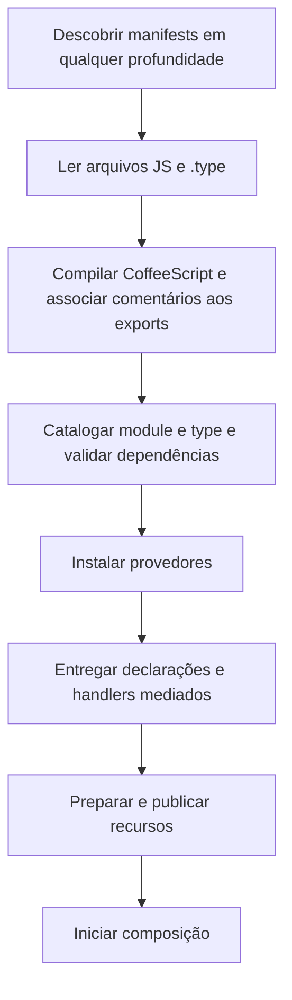

# LógosType: arquivos `.type`

A primeira versão de LógosType usa **CoffeeScript 2 convencional**, sem gramática
adicional. O compilador vem de [ThinkIac/LogosType](https://github.com/ThinkIac/LogosType),
um fork do CoffeeScript. O Lógos descobre, compila em memória e carrega `.type`
nativamente, junto de `.js`, `.cjs` e `.mjs` no mesmo pacote. Não há build manual
nem arquivos JavaScript gerados no workspace.

## Instalação pelo GitHub

A instalação direta foi validada:

```bash
npm install ThinkIac/LogosType#main
```

O nome atual do pacote nesse repositório é `coffeescript`. Portanto, a dependência
no manifest do Lógos é:

```json
{
  "dependencies": {
    "coffeescript": "github:ThinkIac/LogosType#main"
  }
}
```

Não é necessário instalar novamente no pacote consumidor: o Lógos distribui essa
dependência de linguagem. Ela não instala provedores de HTTP, views ou banco.
O compilador é carregado somente ao processar `.type`. `#main` acompanha a branch;
o `package-lock.json` da raiz fixa o commit resolvido para instalações com `npm ci`.
Para atualizar o compilador, atualize também esse lockfile e execute os testes.
A instalação Git requer acesso ao GitHub.

## Comentários e exports

Use o bloco CoffeeScript acima da atribuição exportada:

```coffee
###
# @register router
# @name status
# @method get
# @public true
#
###
exports.status = (req, res) ->
  res.json ok: true
```

O formato solicitado `###`, linhas com `#`, e `###` é aceito diretamente.
O lexer distingue comentários reais de textos contendo `###`. O scanner associa
os metadados à atribuição original, inclusive quando CoffeeScript gera funções
anônimas em JavaScript. O bloco deve começar na primeira coluna e preceder a
atribuição; use `exports.nome = ...` ou `module.exports.nome = ...`.
Também é possível declarar uma função local e depois exportá-la pelo mesmo nome.
Comentários internos à função não fazem parte do contrato inicial de `.type`.

`@register router` sem nome chega ao catálogo como declaração sem nome. O provedor
define o significado e seus requisitos. O módulo HTTP existente exige nome na
própria declaração (`@register router status`) ou em `@name`, como no exemplo.
A extensão não cria um tipo `router` nem instala HTTP automaticamente.

## Provedor e consumidor completos

A posição no workspace não muda a semântica:

```text
packages/
├── modules/arithmetic/
│   ├── package.json
│   └── index.type
└── abc/b/customer/
    ├── package.json
    └── actions.type
```

`modules/arithmetic/package.json`:

```json
{ "name": "@example/arithmetic" }
```

`modules/arithmetic/index.type`:

```coffee
###
# @register module arithmetic
#
###
exports.lifecycle = (context) ->
  close: -> context.state.clear()

###
# @register type arithmetic
#
###
exports.accept = (resource, context) ->
  context.state.set resource.declaration.name, resource.handler
```

`abc/b/customer/package.json`:

```json
{ "name": "customer" }
```

`abc/b/customer/actions.type`:

```coffee
###
# @register arithmetic double
#
###
exports.double = (value) -> value * 2
```

Host JavaScript:

```js
const path = require('node:path');
const { bootstrap } = require('logos');

async function main() {
  const runtime = await bootstrap({
    workspace: path.resolve('packages'),
    externalModules: [],
  });
  try {
    const state = runtime.container.state('entrypoint:workspace:modules/arithmetic');
    console.log(await state.get('double')(21)); // 42
  } finally {
    await runtime.close();
  }
}
main().catch(error => { console.error(error); process.exitCode = 1; });
```

Não há import de API de registro do Lógos nos arquivos `.type`. Como em JavaScript,
o consumidor simples desse exemplo não reverte efeitos arbitrários. Para recursos
que exigem troca atômica, implemente o consumidor transacional descrito em
[modules.md](modules.md#transactional-resource-consumers).

## Fluxo



O Lógos conhece o formato de execução e as declarações estruturais. Os módulos
continuam responsáveis pela semântica de router, tool, view e outros recursos.
A descoberta estrutural e a descoberta de recursos usam o mesmo compilador.

## Dependências, recarga e diagnósticos

Um `.type` pode carregar CommonJS, JSON, bibliotecas npm e outro `.type` local:

```coffee
helper = require './lib/helper.type'
###
# @register arithmetic answer
#
###
exports.answer = -> helper.answer()
```

Para dependências `.type`, escreva a extensão explicitamente. O carregador local
não instala `require.extensions` global. Importar `.type` diretamente por `require`
de um arquivo JavaScript ou por `import` ESM não é parte desta primeira versão.
Os `.type` descobertos pelo Lógos usam CommonJS inclusive em pacotes com
`"type": "module"`; `import` e `export` ESM dentro deles não são suportados.

A recarga invalida o cache CommonJS do pacote, incluindo helpers `.type`.
O estabilizador observa esses fontes e os inclui no hash dos candidatos.
Erros de compilação ou preparação impedem a publicação da nova geração;
consumidores transacionais conservam a geração ativa. Código de topo de arquivo
continua sendo código executável: efeitos fora do protocolo não ganham rollback.
Mudanças em definições de módulos e tipos continuam exigindo novo boot, assim
como em JavaScript.

Erros de sintaxe incluem o caminho `.type` e a localização do compilador.
O JavaScript em memória contém source map inline com o fonte original. Para
stacks de execução mapeados às linhas CoffeeScript, inicie Node com:

```bash
node --enable-source-maps host.cjs
```

## Isolamento

Pacotes isolados compilam e executam dentro do processo limitado fornecido por
`isolated-runtime`. O bootstrap recebe leitura do carregador de linguagem e do
compilador; o código do pacote continua sem import livre de módulos nativos,
sem import fora da própria raiz e com chamadas mediadas por IPC.
Dependências `.type` passam pela verificação do caminho real antes de carregar.
A compilação não cria uma nova fronteira de segurança nem concede capacidades.

## Validação

```bash
npm run build
npx vitest run tests/type-source.test.ts
npm run test:independent
```

Os testes cobrem blocos com `#`, funções anônimas, router e `@name`, módulos e tipos
em pastas profundas, coexistência com JavaScript, dependências locais, source maps,
recarga, erro de compilação, candidatos e execução isolada com bloqueio de escapes.
O teste de distribuição usa o artefato empacotado em projeto temporário sem módulos
adjacentes; copia o compilador instalado para manter essa verificação offline.
