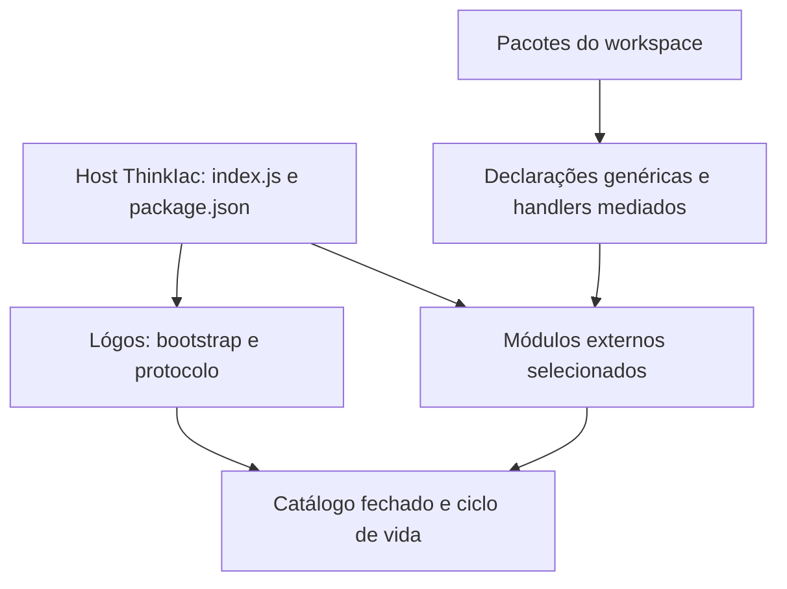

# Estrutura e operação do Lógos

## Três camadas

O host escolhe recursos e política de produto. O launcher fornece uma superfície
de composição. Os módulos implementam os recursos e liberam o que adquiriram.
O kernel ainda mantém registro de pacotes, autoridade, serviços, efeitos e
contratos genéricos; independente não significa um pacote sem coordenação.

## Mapa do código

Caminhos relativos ao pacote `vendor/packages/logos`:

| Local | Responsabilidade |
| --- | --- |
| `src/index.ts` | Boot único, ativação de pacotes, encerramento e exports compatíveis |
| `src/types.ts` | Configuração e resultado público, incluindo opções legadas |
| `src/kernel/container.ts` | Instância, catálogo, dependências, fases e estado por namespace |
| `src/kernel/module-context.ts` | Contexto público e registro de entrypoints nativos |
| `src/kernel/external-modules.ts` | Descoberta por manifest, resolução e carregamento |
| `src/kernel/module-resolution.ts` | Resolução de capacidades e aliases compatíveis |
| `src/kernel/runtime-protocol.ts` | Envelopes de ciclo de vida v1 |
| `src/kernel/declaration-events.ts` | Coleta e entrega mediada de declarações |
| `src/kernel/resource-transactions.ts` | Gerações preparadas, publicação e compensação |
| `src/kernel/registry.ts`, `manifest.ts`, `logos-dependencies.ts` | Pacotes e contratos estruturais |
| `src/kernel/bus.ts`, `event-contracts.ts`, `event-governance.ts` | Eventos, schemas e governança |
| `src/kernel/authority-context.ts`, `access-controller.ts` | Autoridade de execução |
| `src/kernel/services.ts`, `effects.ts`, `lifecycle.ts` | Serviços e escopos com descarte |
| `src/kernel/scan.ts`, `parsers.ts`, `declarations.ts` | Declarações genéricas e adaptadores compatíveis |
| `src/modules/`, `src/stabilizer/`, `src/database/`, `src/core/isolated/` | Contratos, pontes e fachadas históricas |
| `tests/` | Protocolo, independência e regressões de compatibilidade |
| `dist/` | Saída de compilação publicada, incluindo declarações TypeScript |

As implementações concretas ficam em `../modules/<capacidade>`. Diretórios
`compat/` desses módulos preservam comportamento de imports antigos. O código
experimental de cliente browser é um artefato compatível fora do grafo de boot.

## Seleção e configuração

| Campo | Efeito |
| --- | --- |
| `workspace` | Caminho dos pacotes; padrão `PACKAGES_PATH` ou `<cwd>/packages` |
| `externalModules` | Caminhos ou pacotes selecionados; ausente permite descoberta adjacente |
| `modules` | Declarações programáticas `LogosModule`, com acesso de baixo nível ao container |
| `moduleConfig` | Configuração nativa por identidade de seleção do entrypoint |
| `logosDependencies` | Resolução de dependências estruturais de pacotes |
| `eventGovernance` | Política de entrega de eventos |
| `http`, `port`, `host`, `cors`, `middleware` | Configuração interpretada pela capacidade HTTP |
| `views`, `workers`, `hotReload`, `mcp`, `storage`, `repo` | Configuração das capacidades correspondentes |

A lista completa e os tipos estão em `src/types.ts`; o contrato efetivo de cada
capacidade é definido pelo módulo. `port: false` não equivale a remover HTTP:
apenas desativa a escuta quando esse módulo está instalado.

Um pacote pode declarar `runtime: { role: "module", entry: "index.cjs" }` no
manifest. A descoberta adjacente lê esses campos sem executar bibliotecas não
selecionadas. Um entrypoint declarado não pode escapar do diretório do pacote.
Entrypoints explícitos devem exportar `register` ou a fábrica compatível;
falhas de resolução ou carregamento interrompem o boot.

`moduleConfig['./arithmetic']` configura a seleção `externalModules:
['./arithmetic']`, mesmo que ela registre o nome `arithmetic`. O contexto recebe
uma cópia congelada superficialmente dessa configuração e um Map próprio.
Isso não constitui isolamento de segurança para JavaScript confiável no processo.

## Sequência de boot

1. Cria container, registro, barramento e serviços genéricos; define o container
   padrão e `process.env.PACKAGES_PATH` para compatibilidade.
2. Carrega entrypoints externos e declarações programáticas; emite
   `logos:starting` e `logos:modules:register`.
3. Resolve dependências dos pacotes e coleta módulos e tipos de todos os pacotes do workspace.
4. Valida as duas fases, conflitos de recursos e provedores; sela o catálogo.
5. Instala `boot` e depois `wire`, respeitando `requires` e `after`.
6. Aplica a política do Supervisor, se presente, e conecta todos os pacotes:
   valida contratos, configura serviços e schemas, emite `package:wiring` e
   entrega recursos genéricos.
7. Expõe a operação de ativação, executa todos os `prepare`, depois todos os
   `start`, marca prontidão e emite `logos:ready` e `runtime:ready`.

Uma falha de conexão de pacote marca `denied_contract` e limpa sua autoridade de
serviços/schemas e runner; não implica sempre rejeição de todo o boot. Falhas
estruturais de módulos ou de seus instaladores rejeitam o boot e acionam limpeza.
Prontidão do runtime não prova que todos os pacotes ficaram ativos.

## Ativação, recarga e encerramento

A ativação é serializada por pasta. O locator aceita qualquer profundidade
com segmentos válidos, sem caminhos absolutos ou travessia. Adicionar um provedor que precise
alterar o catálogo selado falha; reinicie com a composição desejada.
Descoberta periódica e observação de arquivos pertencem ao `stabilizer`, quando
selecionado. O kernel oferece coordenação e entrega de recursos, não um watcher.

O estabilizador coordena candidatos e troca de pacotes. Consumidores nativos
transacionais recebem snapshots completos, inclusive vazios para remoção.
Listeners legados devem compensar seus próprios efeitos. O rollback não impede
que leitores concorrentes vejam etapas intermediárias entre consumidores.

`close()` é idempotente. Remove prontidão, emite parada, encerra runners,
aguarda transações, descarta gerações, fecha módulos em ordem inversa de aquisição,
dispõe escopos e remove assinaturas dos entrypoints. A limpeza tenta os demais
itens após uma falha e agrega erros. `close` de módulo deve aceitar instalação
parcial; promessas arbitrárias precisam cooperar com cancelamento.

## Resultado público e múltiplas instâncias

`bootstrap()` retorna `workspace`, `container`, `bus`, `close`, `app`, `server`,
`stabilizer`, `mcp` e `workers`. Capacidades ausentes retornam `null` nos campos
correspondentes. Usar uma fachada que exige uma capacidade ausente gera erro
explícito de indisponibilidade.

Prefira referências da instância. Exports soltos usam o container padrão mais
recente, e `PACKAGES_PATH` é global ao processo. Estado por container permite
instâncias simultâneas, mas não torna consumidores de globais automaticamente
seguros. Módulos devem usar estado e escopos próprios e remover listeners,
timers, sockets e processos ao encerrar.

## Distribuição

O manifest publica `dist`, `docs`, README, guia de migração e licença. O entrypoint
é `dist/src/index.js`; tipos em `dist/src/index.d.ts`. As ferramentas de build e
as bibliotecas usadas por testes de compatibilidade estão em `devDependencies`.
O peer `scriba` é opcional. Recursos concretos exigem seus pacotes instalados
pelo host; o launcher não os baixa nem os instala implicitamente.

O teste de distribuição empacota sem executar scripts, extrai em projeto
temporário e proíbe imports de capacidades no boot vazio. Também verifica tipos
públicos e instalação separada do módulo de workers. Isso cobre a separação do
artefato local; publicação e aceite do Runtime exigem validação própria.

## Catálogo de pacotes externos

Lista da distribuição `vendor/packages/modules`. Os provedores usam declarações
`@register module`. A descoberta externa de compatibilidade lê `runtime.entry`;
no workspace todos os manifests são descobertos recursivamente, sem distinção
de papel. Veja [workspace.md](workspace.md). O host ainda pode compor módulos
programáticos. A tabela descreve o conteúdo dos pacotes, não uma classificação
obrigatória do workspace.

| Diretório | Nome no manifest | Papel declarado |
| --- | --- | --- |
| `annotations` | `@thinkiac/module-annotations` | `biblioteca/ferramenta` |
| `commands` | `@thinkiac/module-commands` | `module` |
| `credentials` | `@thinkiac/module-credentials` | `module` |
| `db` | `@thinkiac/module-db` | `module` |
| `env` | `@thinkiac/module-env` | `module` |
| `hooks` | `@thinkiac/module-hooks` | `module` |
| `http` | `@thinkiac/module-http` | `module` |
| `isolated-runtime` | `@thinkiac/module-isolated-runtime` | `module` |
| `legacy-entry` | `@thinkiac/module-legacy-entry` | `module` |
| `mcp` | `@thinkiac/module-mcp` | `module` |
| `mediated-io` | `@thinkiac/module-mediated-io` | `biblioteca/ferramenta` |
| `proc` | `@thinkiac/module-proc` | `module` |
| `process-bridge` | `@thinkiac/module-process-bridge` | `biblioteca/ferramenta` |
| `repo` | `@thinkiac/module-repo` | `module` |
| `runtime-compat` | `@thinkiac/module-runtime-compat` | `biblioteca/ferramenta` |
| `scriba-rooms` | `@thinkiac/module-scriba-rooms` | `biblioteca/ferramenta` |
| `stabilizer` | `@thinkiac/module-stabilizer` | `module` |
| `storage` | `@thinkiac/module-storage` | `module` |
| `supervisor` | `@logos/supervisor` | `module` |
| `svelte` | `@thinkiac/module-svelte` | `module` |
| `task-runner` | `@thinkiac/module-task-runner` | `biblioteca/ferramenta` |
| `tools` | `@thinkiac/module-tools` | `module` |
| `websocket` | `@thinkiac/module-websocket` | `biblioteca/ferramenta` |
| `websocket-runtime` | `@thinkiac/module-websocket-runtime` | `module` |
| `workers` | `@thinkiac/module-workers` | `module` |

A composição atual do `index.js` raiz seleciona comandos, credenciais, banco,
ambiente, hooks, HTTP, isolamento, entrada legada, MCP, processos, repositório,
estabilização, armazenamento, Svelte, ferramentas, WebSocket e workers.
O Supervisor entra como módulo programático. Extensões de bootstrap podem
ajustar a configuração do host. Essa composição pertence ao ThinkIac, não
ao pacote Lógos. Consulte cada manifest para dependências e versão de Node;
o mínimo do launcher não garante o mínimo de todos os módulos.

## Fontes LógosType

`src/kernel/type-source.ts` compila CoffeeScript 2 em memória e carrega `.type`
como CommonJS. `scan.ts` associa comentários às funções exportadas e usa o
catálogo existente. O compilador vem de `ThinkIac/LogosType#main`; as capacidades
continuam externas. Veja [LógosType](logos-type.md) para fluxo e exemplos.
